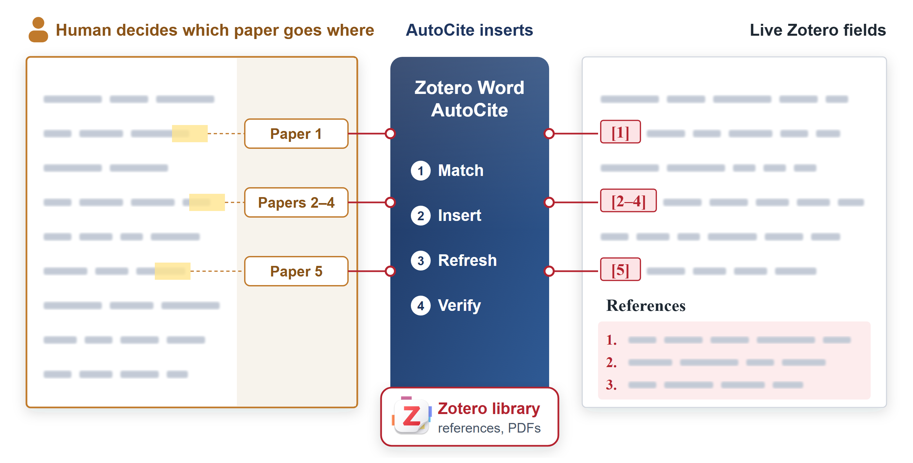

# Zotero Word AutoCite

**English** | [简体中文](README.zh-CN.md)

Inserting one citation with Zotero's Word add-in is quick; placing dozens of them across a manuscript from a citation plan is not. This Codex Skill handles that step. It matches the references you have selected to their intended locations, inserts or edits Zotero fields through Zotero's Word integration, and refreshes and verifies the bibliography. The citations remain live and editable in the add-in.

> [!NOTE]
> **Human-in-the-Loop.** This Skill handles repetitive research tasks; it supports research rather than doing it. Keep questions, judgments, and conclusions with people, and check every result before use.



Citation plans can be notes, tables (Markdown, CSV, JSON, Excel), or Word comments; references can be Zotero items or PDFs with metadata. Which papers support which statements, and in what order, remains the author's decision: where the plan is incomplete, the workflow reports the gaps rather than filling them. For finding and downloading papers, see [ScholarFetch](https://github.com/LiX-Works/ScholarFetch).

## Tasks

| Task | Input | Result |
|---|---|---|
| Read-only check | A question or files | Findings |
| Prepare citation inputs | Decisions, notes, tables, or Word comments | Citation task table and reference mapping |
| Prepare Zotero | Verified records, PDFs, or an existing collection | Import plan or prepared items, as authorized |
| Insert citations | Word file, citation plan, sources, and style | Working copy with Zotero fields and bibliography |
| Adjust citations | Word file with Zotero fields and specified changes | Targeted changes; other citations preserved |
| Refresh and verify | Word file with Zotero fields | Refreshed working copy, existing style kept |

## Getting started

Requires Windows, desktop Word, Zotero with its Word add-in, Python 3, and PowerShell; new documents also need a citation style. Before writing, the workflow checks Zotero's local API and the Word integration DLL; it does not install either.

The repository root is the Skill folder. To install it as a personal Codex Skill:

```powershell
git clone https://github.com/LiX-Works/Zotero-Word-AutoCite.git (Join-Path $env:USERPROFILE '.codex\skills\zotero-word-autocite')
```

Example request:

```text
Use $zotero-word-autocite. The project is at C:\path\to\project,
and the target file is manuscript.docx.

Use the project's citation plan and reference sources to insert Zotero
citation fields at the specified locations. Use the citation style I have
selected, then refresh and check the bibliography.
```

For an existing document, identify the passage and the reference changes. A refresh-only request needs no citation plan. The Skill and workflow guides are in English.

## Safeguards

- Edits go to a working copy; the source document is preserved.
- Reference identities are checked before any write. An operation stops when an identity or location is ambiguous, inputs conflict, or the save state is uncertain.
- The batch scripts (`build_payload.py`, `insert_zotero_fields.ps1`) add citations; replacing or removing existing groups uses targeted field edits.
- Zotero imports require authorization and a database backup. Nothing deletes library items, PDFs, or existing citations by default.
- A task is complete only when the saved document's fields, cited items, and bibliography have been checked.

## Documentation and tests

| File or folder | Purpose |
|---|---|
| [SKILL.md](SKILL.md) | Task instructions and entry point |
| [Workflow overview](workflow/README_FIRST.md) | Choose between checking, preparation, insertion, adjustment, and refresh |
| [Input preparation](workflow/PREPARE_CITATION_INPUTS.md) | Interpret existing materials and prepare citation tasks and mappings |
| [Word–Zotero workflow](workflow/ZOTERO_WORD_AUTOMATION_WORKFLOW.md) | Field operations, refresh, troubleshooting, and verification |
| [Scripts](workflow/zotero_word_automation/scripts/) and [templates](workflow/zotero_word_automation/templates/) | Supporting operations and example input formats |
| [Tests](workflow/zotero_word_automation/tests/) | Offline regression tests |

```powershell
python -m unittest discover -s workflow/zotero_word_automation/tests -v
```

The offline tests do not launch Word or Zotero and do not establish live insertion or refresh on a particular machine.

Released under the [MIT license](LICENSE).
